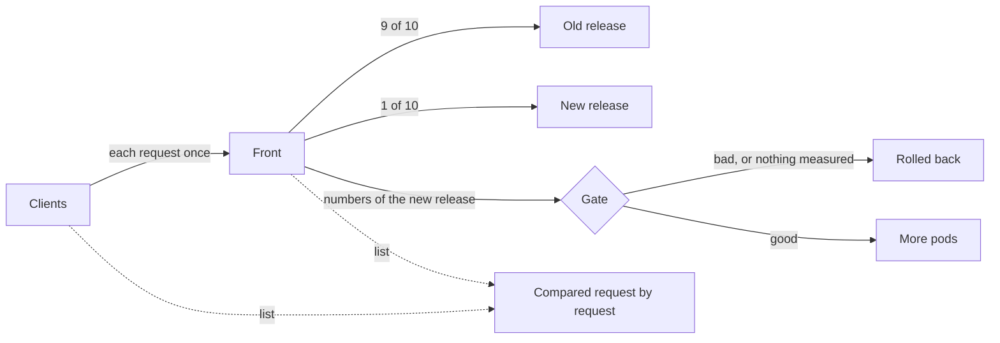

# k8s-platform-lab

Rolls a bad release back by itself, and counts the errors that users saw until then. The company behind it is made up: no
shop, customer or order in here is real.

**No cluster has run yet.** Only the tests that need none have. It becomes a claim when a public run shows it.

## The claim

> A bad release rolls itself back, and the errors that users saw are counted.

| | |
|---|---|
| [What it has to survive](docs/contract.md) | 18 things that can happen, what must be true afterwards, and what is not covered |
| [What a bad release is](docs/decisions/0001-bad-release.md) | The numbers, why they are these, and what they let through |
| [The stand-in](standin/app.py) | Answers like the program of webhook-platform and fails on purpose, until that program has an image |
| [The clients](clients/clients.py) | Send each request once, whatever the answers do, and write down what came back |
| [The front](front/nginx.conf) | Writes one line for each answer. It repeats nothing and hides nothing. [Beside it](front/tally.py) the lines become numbers |
| [Counted from outside](count/count.py) | Compares both lists, request by request. Anything that is not explained ends the run |
| [The judge](count/judge.py) | Says whether the run was what the contract asks for. What the controller says about itself is only one part |
| [The walker](docs/walker.md) | Walks through the merged list of releases inside of the cluster. What it cannot do is tried, as the walker, in every pull request |
| [Tests that can fail](tests/wrong.py) | More than 100 mistakes that are easy to make, one at a time. The tests have to notice each of them |

## How it works

- **The gate reads only the new release.** 20% errors in 1 of 10 pods would look like 2% otherwise.
- **It reads the front, not the pods.** A pod that dies cannot count the answer that it did not give, and a bad release may
  count wrongly. So nothing in the cluster needs a right for it either.
- **No numbers are not good numbers.** A release that nobody asked, or that cannot be measured, is rolled back.
- **What decides is checked from outside.** The gate trusts the front. The clients, who are outside, have a list of their own, and
  every line of both has to agree.
- **Nobody outside has a right in the cluster.** A list of releases is merged, and the walker tries them. Its only right is to
  change two settings of one object.
- **The same on every cluster.** [One folder](k8s/clouds) for each place, and nearly nothing in it.
- **No load balancer that Kubernetes makes, and no disk,** because a cloud would make them outside of what the code knows, and
  they would stay.

## Who made what

The numbers of the gate, the design, the code and the tests are by Claude. The owner of this repo chose the idea, decided to
use those numbers, and approves every change.
